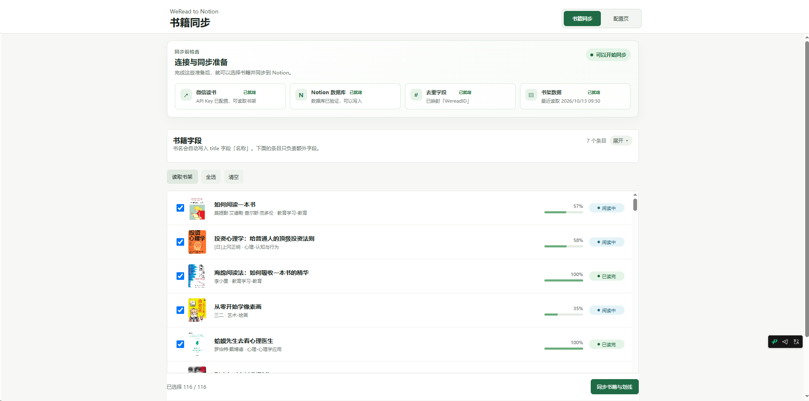
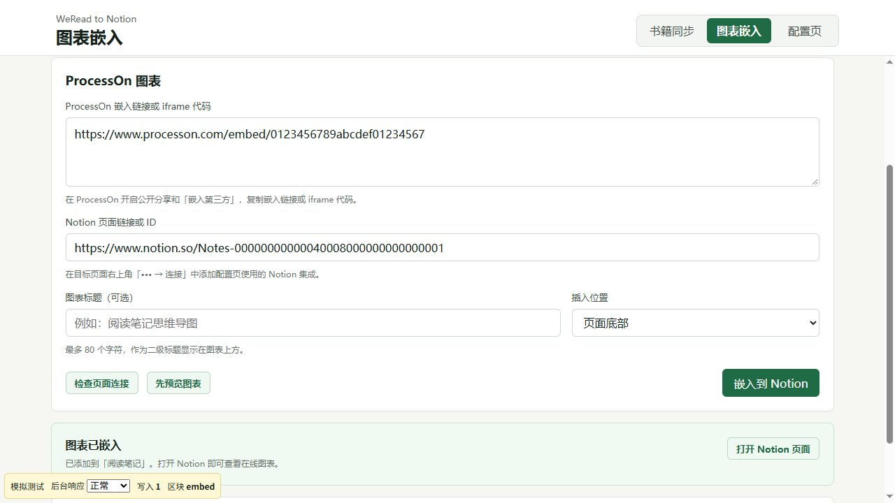
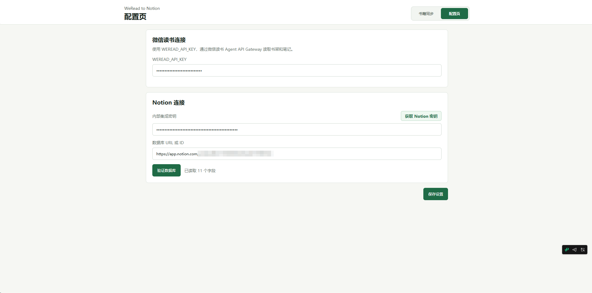

# WeRead to Notion

Chrome Manifest V3 插件，用于把微信读书书架、阅读进度、划线和想法同步到 Notion 数据库，并将 ProcessOn 在线图表嵌入指定的 Notion 页面。

## 演示

### 书籍同步



### 图表嵌入

使用模拟数据展示独立分页、嵌入表单与统一提示。



### 配置页



## 功能

- 通过微信读书 Agent API Gateway 和个人 API Key 读取数据。
- 在同一个扩展页内，通过独立分页完成书籍同步、图表嵌入和配置。
- 图表嵌入复用配置页保存的 Notion 密钥，支持 ProcessOn 官方嵌入链接或 iframe 代码、可选二级标题、页面顶部或底部插入。
- 可只读检查目标页面连接、预览图表；嵌入前分页检查页面顶层已有图表，避免重复添加。
- 读取书架、默认全选、手动同步，并配置书籍字段条目。
- 配置页设置 Notion 内部集成密钥、数据库 URL/ID。
- 书名默认写入 Notion 数据库自带的 title 字段。
- 新建页面时使用目标数据源设置的默认模板；未设置默认模板时创建空白页面。
- 字段条目可选择 Notion 字段、微信读书字段或自定义内容。
- 可将微信读书封面设置为 Notion 页面封面。
- 使用 `WeRead ID` 字段查询已有页面，重复同步时更新而不是重复创建。
- 字段可独立设置是否覆盖更新。
- 每本书只对应一个 Notion 页面，书籍字段写入页面属性，划线与想法放在默认颜色的 Callout 中；其首个子块是“微信读书划线与想法（自动同步）”一级标题，后面是章节标题与划线。Callout 内容直接显示，标题可进入页面目录。
- 每次同步都会新建完整划线区，读回核对内容和顺序后归档旧划线区；写入失败时保留旧内容。旧版平铺划线区会在首次成功写入后清理。
- 微信读书章节读取失败，或划线与想法明细少于笔记本概览数量时，该书会报错并保留原划线区。
- 划线区内的手工修改会在下次同步时被微信读书内容覆盖；请把手工内容放在该 Callout 之外。

## Notion 数据库要求

目标数据库必须包含：

- Notion title 字段：字段名不限，扩展会自动识别并写入书名。
- `WeRead ID`：建议使用 rich text 或 select 字段，用于去重。

可选字段类型：

- 封面：url 或 files。
- 阅读进度：number。
- 作者、WeRead ID：rich text 或 select。
- URL：url 或 rich text。
- 阅读状态：select、status 或 rich text。

如果使用 status 字段，请先在 Notion 中准备好“未开始”“阅读中”“已读完”三个选项。

## 开发

```bash
npm install
npm test
npm run build
```

构建后在 Chrome 打开 `chrome://extensions`，启用开发者模式，选择 `dist` 目录加载已解压的扩展。

## 使用

1. 准备格式为 `wrk-...` 的微信读书个人 API Key。
2. 创建 Notion 内部集成，复制密钥，并把目标数据库授权给该集成。
3. 打开扩展设置页，填写 `WEREAD_API_KEY`。
4. 填写 Notion 密钥和数据库 URL/ID，点击“验证数据库”。
5. 到“书籍同步”页配置字段条目并保存。
6. 点击“读取书架”，勾选要同步的书，再点击“同步书籍与划线”。
7. 同步后，划线与想法会出现在对应书籍页面的默认颜色 Callout 中，“微信读书划线与想法（自动同步）”显示为其中的一级标题。

同步会读取页面顶层块以识别旧划线区，随后只核对新划线区的子块。写入按最多 100 个块分批，同时控制 UTF-8 请求大小；遇到 429 时按 `Retry-After` 等待，最多重试 3 次。限制依据 [Notion 请求限制](https://developers.notion.com/reference/request-limits)。

## ProcessOn 图表嵌入

1. 在配置页填写并保存 Notion 内部集成密钥。只使用图表嵌入时，无需配置微信读书或验证书籍数据库。
2. 确认集成具备「读取内容」和「插入内容」权限，并在目标 Notion 页面右上角「••• → 连接」中添加该集成。
3. 在 ProcessOn 开启公开分享和「嵌入第三方」，复制 `https://www.processon.com/embed/…` 链接或 iframe 代码。
4. 切换到「图表嵌入」，填写图表与目标页面链接，按需填写标题并选择顶部或底部。
5. 可以先点击「检查页面连接」和「先预览图表」，再点击「嵌入到 Notion」。完成后可打开对应的 Notion 区块。

此功能通过后台调用 Notion 官方 API 创建原生 `embed` 区块。密钥仍只保存在扩展的本地配置中，不需要 ProcessOn 连接凭证。修改配置并保存后，本页会自动更新连接状态，下次操作使用最新密钥。

重复检测仅覆盖页面顶层，包含所有分页；折叠、分栏和 Callout 内的图表不在检测范围内。相同页面和图表的并发提交会共用一个后台任务。若请求超时、连接中断或 Notion 未确认写入结果，会显示目标页面链接，请先查看页面再重试；写入请求不会自动重试。

图表显示与更新取决于 ProcessOn 的分享与嵌入权限、访问密码、有效期和网络。预览无法显示时，可以打开原图检查；保存图表修改后若 Notion 未立即更新，请刷新页面。

图表嵌入适配自 [processon-notion-embed](https://github.com/yejinshengge/processon-notion-embed)，保留 MIT 许可，见 [许可文件](public/licenses/processon-notion-embed.txt)。图表接口使用 `Notion-Version: 2026-03-11`，书籍同步继续使用现有的 API 版本。

## 说明

微信读书读取统一通过 `POST https://i.weread.qq.com/api/agent/gateway` 完成。当前适配官方 Skill `1.0.5`，每次请求都会携带 `skill_version`，业务参数与 `api_name` 同层传递；API Key 仅保存在扩展的本地存储中。

书籍 URL 优先使用接口返回的 `readerLink`（阅读器链接），没有时使用 `deepLink`（书籍详情链接）；两个字段均缺失时省略 URL。接口返回 `upgrade_info` 时会停止读取，并显示升级提示及下载地址。
